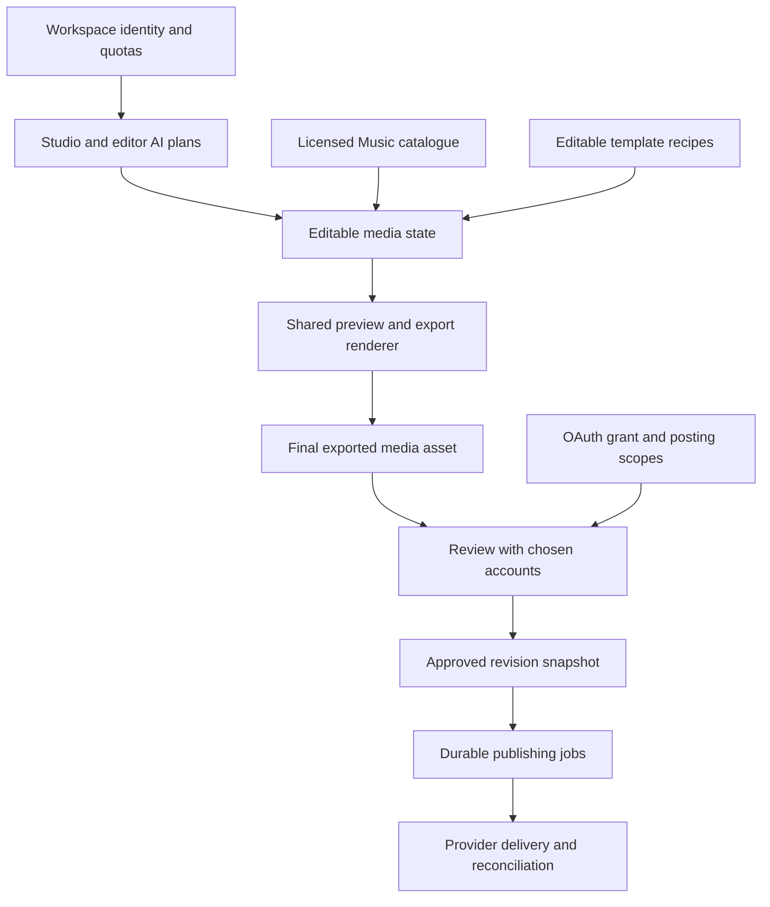

# Orbit implementation workflow, 23 October 2026

This is the current engineering order and evidence boundary. A configured key,
connected account or successful build does not establish a usable end-to-end
feature. The delivery checkpoint records actual test results separately.

## Priority and actual state

| Order | Area | Current state | Completion gate |
| --- | --- | --- | --- |
| 1 | API/auth/database | Shared feature Preview ready, database connected. Production remains separate | Signed-in workspace flow on matching web/API |
| 2 | Gemini Studio and media planning | Three real synthetic provider paths passed on 3.5 Flash Lite. Strict plan validators remain | Signed-in generation, save/reload, Apply/Undo and usage limits |
| 2 | Cloudflare image pixels | Real provider returned a valid image. Visual instruction correctness not assessed | Use a reviewable input, inspect resulting image, reload final asset |
| 3 | Media engine | Layer resizing fixed and real exported pixels verified. Chroma key passed real export pixel acceptance | Preview/export agreement, audio/timing, cleanup, source replacement |
| 3 | Sequential stitch | Sequential two-clip stitch passed preview/export pixel and source audio checks | Simultaneous reaction layout and native social-platform Stitch remain separate |
| 4 | Music | Anonymous upstream access denied; server-side registered access adapter added, no credentials supplied | Real search, preview, selection, audible export with legitimate catalogue access |
| 4 | Templates | Before/After uploaded media recipe passed browser acceptance | Editable slots/text, missing-slot guard, real export and Undo |
| 5 | OAuth connection | Facebook prior grant verified. Instagram/Threads consent still unresolved. TikTok owner setup deferred | Actual provider consent and workspace account record for each provider |
| 6 | Social Share | Native file sharing exists. Real provider publishing absent. Studio draft account selection saved against revision; per-account capabilities are truthful | Approved destination/revision, durable media upload, job idempotency and confirmed provider result |
| 7 | Ponytail design/motion | Source read, MIT attribution retained; Home spacing/type/colour adaptation verified at four widths | Full design and animation parity review across requested screens |

## Ownership and integration

- Parent supervises integration, release configuration, Music and acceptance.
- Media agent owns video editor/chroma renderer and its focused tests.
- Design agent owns image recipe/editor and its focused tests.
- OAuth agent owns status/Channels capability reporting and tests; no posting.
- No two agents modify the same source file simultaneously. Review the combined
  diff and run focused checks before committing. Feature integration uses the
  existing configured Preview branch; production promotion is separate.

## Publishing work that must precede enabling live delivery

1. Studio now saves selected account IDs against the current workspace and draft revision. Media must be connected to that reviewed asset/destination contract next.
   Verify ownership on the server. Editing text, media or destinations invalidates
   previous approval and schedules.
2. Store the actual exported bytes durably with checksum and immutable asset ID.
   A browser blob URL cannot be fetched by a social provider. Use a bounded
   provider-fetchable delivery URL for the approved export.
3. Persist the approved payload/revision in each publishing job. Reserve once
   per revision/account using a database uniqueness/idempotency boundary.
4. Add real Facebook/Threads connectors. Record the Threads container before
   publishing. A timeout after dispatch is ambiguous and must be reconciled
   before retry, to prevent duplicate posts.
5. Obtain actual additional posting permission through explicit OAuth consent.
   Current basic connection grants do not acquire new scopes from environment
   changes. Preserve connected status independently from posting capability.
6. Test with one explicitly approved owner test post and confirm its provider
   ID/permalink. Until then keep livePublishing false.

## Owner-dependent gates

- Music registered credentials/setup are documented in MUSIC_ACCESS_SETUP.md.
  Do not repeat Gemini key setup; that key has already been supplied and tested.
- Instagram requires verification of the app use case, granted permission and
  linked professional account/Page. The reported invalid-scope screenshot alone
  does not establish a code fix.
- Threads needs the exact failed consent response and app/tester access verified.
- TikTok remains deferred by the owner; avoid repeated developer registration.

No billing activation, production release, database migration or social post is
part of this checkpoint.
